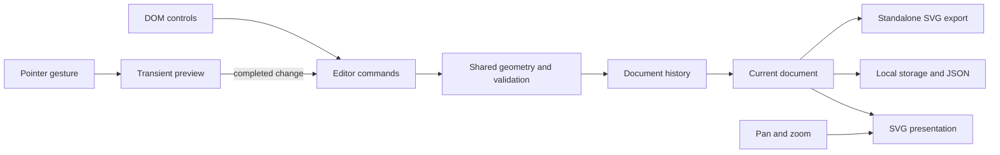

# Architecture

Planar Studio separates the editable plan from the view used to inspect it. The document describes a room and furniture in centimetres. React renders that data into SVG and DOM controls. The renderer does not own the saved geometry, and moving the viewport is not a document edit.

## Ownership

| Location                                                      | Responsibility                                                                 |
| ------------------------------------------------------------- | ------------------------------------------------------------------------------ |
| `src/model/types.ts`, `constants.ts`                          | Versioned document, units, supported kinds/materials, and limits               |
| `src/model/catalog.ts`, `templates.ts`                        | Furniture defaults and complete example layouts                                |
| `src/model/geometry.ts`                                       | Rotation, snapping, rotated extents, containment, and item fitting             |
| `src/model/serialization.ts`                                  | Strict document validation and JSON parsing/serialization                      |
| `src/model/history.ts`                                        | Bounded document snapshots, undo/redo, and branch replacement                  |
| `src/editor/commands.ts`                                      | Shared item/room changes, adding, and duplication                              |
| `src/editor/persistence.ts`                                   | Optional local saving and preservation of unreadable saves                     |
| `src/editor/usePlanner.ts`                                    | Current history, selection, editor commands, save status, and errors           |
| `src/scene/PlanCanvas.tsx`, `FurnitureArt.tsx`, `RoomArt.tsx` | Interactive SVG composition and reusable document artwork                      |
| `src/scene/usePlanGestures.ts`, `viewport.ts`                 | Gesture previews/cancellation, world coordinates, pan, zoom, and fit bounds    |
| `src/scene/exportSvg.tsx`                                     | Presentation-only SVG generated from document data                             |
| `src/ui`                                                      | Catalog, object list, inspector, toolbar, file controls, and keyboard commands |

`usePlanner` exposes commands rather than mutable renderer objects. Selection is transient; changing it does not consume an undo step. Model documents are copied at history boundaries, and validation reconstructs supported data before accepting a replacement.

## Document and units

`PlanDocument` version 1 contains a name, room, and items. Room dimensions are centimetres. Furniture uses center coordinates `(x, y)`, unrotated width/depth, and degrees of rotation around its center. Displaying metres in the inspector does not change the stored unit.

Room width/depth range from 200 to 1600 cm. Furniture width/depth range from 20 to 600 cm, with at most 60 pieces. These are deliberately bounded example limits, defined centrally in `constants.ts`. The world origin is the room's top-left corner; positive X runs right and positive Y runs down. Dimensions refer to the room's interior and each item's logical footprint, not decorative shadows.

The two templates contain original furniture arrangements. Their overlapping rugs and furniture are intentional: this editor constrains items to the room but does not prevent item-to-item overlap. The rectangle room model does not encode arbitrary walls, doors, or structural relationships.

## Geometry shared across editing paths

For a rectangle rotated by angle θ, its axis-aligned half-extents are `(abs(cos θ) × width + abs(sin θ) × depth) / 2` horizontally and the corresponding swapped expression vertically. `constrainItem` uses those extents to keep the whole footprint inside the room.

Editor changes normalize rotation and clamp positions. If a rotated item is too large for the room, its dimensions shrink together until it fits, preserving its aspect ratio until either dimension reaches the minimum editable size. Room resizing applies the same function to every item. Pointer snapping is a placement preference; containment still wins at boundaries, so a constrained center need not land exactly on a grid line.

Imports follow a stricter path: unsupported, non-finite, oversized, duplicate-ID, or out-of-room documents are rejected instead of silently repaired. This distinction lets ordinary manipulation remain forgiving while a portable file retains clear meaning. `changeItem`, `changeRoom`, addition, and duplication all pass through shared geometry before commit.

## Gesture and viewport lifetime

A direct manipulation previews transient coordinates and commits once on completion. Cancellation discards the preview, leaving the durable document and history unchanged. An interrupted gesture must not later commit over a new template, imported document, undo, or room edit.

The world transform supplies the mapping from client coordinates to room coordinates. SVG screen matrices account for viewBox sizing, page layout, and viewport transforms. Geometry is never calculated by assuming one CSS pixel equals one centimetre. Pan/zoom and fit-to-view are transient presentation state; they do not alter the exported plan. The viewport clamps zoom to 0.5–2.5 and bounds pan relative to room size. Control/Command-wheel zooms around the pointer; ordinary wheel input remains available to the page. Pan uses the explicit tool, Space-drag, or the middle mouse button. Multi-touch pinch is not implemented.

The SVG and surrounding page expose separate interaction areas. Pointer capture maintains ownership during a drag. Normal completion, cancellation, lost capture, Escape, browser blur, and hidden-page transitions are handled explicitly. DOM controls remain available for selection and precise edits. The editor does not require a permanent animation loop while idle.

## History and persistence

The history reducer keeps up to 50 past document states. A no-op commit preserves the existing state. Undo moves one document into the future stack; a new edit after undo discards that future. Template loading and valid JSON import are ordinary document changes, so they can be undone.

Local saving uses `planar.document.v1`. Unreadable saved data is not overwritten during initial loading: the app shows an example and a recovery message. Before a deliberate subsequent edit replaces that save, the raw unreadable value is copied to `planar.document.recovery.v1`. If saving or recovery fails, the current visit remains usable and the interface reports that portable JSON export is needed.

The browser profile and origin own local storage. It is neither a cloud save nor a trusted shared source. Undo history and selection are not persisted. A loaded document begins a new local editing history.

## Imports and exports

JSON is the editable format. Parsing checks the 1 MB byte limit, exact supported schema version and keys, printable text limits, allowed kinds/materials, six-digit colors, finite/ranged geometry, unique IDs, and rotated containment. Failed import preserves the current plan. Serialization validates again before producing a portable file.

SVG is a presentation format. It renders the complete document independently from the editor's current pan, zoom, selection, or gesture. Shared presentation components keep its geometry and artwork aligned with the live scene. The export must carry its own definitions and styles and must not contain editor handles or depend on external assets. It is not an SVG-import round-trip format. `exportSvg` is asynchronous: it lazy-loads React's static serializer only when exporting and renders the same room/furniture artwork into a fresh presentation tree. This deliberately trades an export-only client chunk for shared, escaped component output; the editor does not serialize its interactive DOM. See the [React API tradeoff](research.md#export-and-scope).

See [extension examples](extending.md) before adding new domain entities or rules, [research](research.md) for the representation tradeoffs, and [Amazi integration](amazi.md) for runtime setup.
