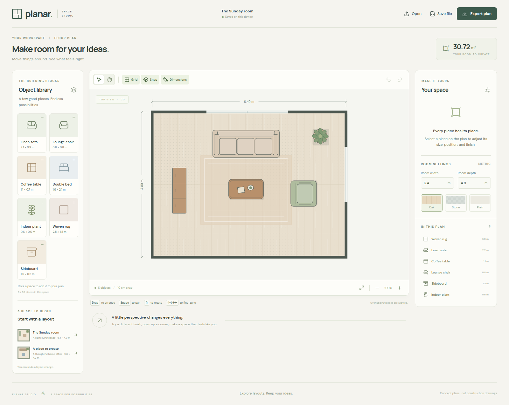

# Planar Studio

Run this guide's commands from the standalone application directory (`web/` in this repository).

An interactive 2D space planner and a reusable foundation for layout visualizations. Arrange
furniture, explore room dimensions and finishes, and save an editable plan or a standalone SVG.
Two furnished examples show the same document model in a living room and a workspace.



## Run

Use Node 22.12+ and the pinned pnpm 11.7.0.

```bash
corepack enable
pnpm install --frozen-lockfile
pnpm dev
```

Open `http://localhost:4440`. The app uses local assets and browser storage; it needs no account,
backend, WebGL, or external media service. For the built desktop app:

```bash
pnpm build
python3 scripts/launch.py
```

The launcher serves `http://127.0.0.1:4441` and opens a browser window. `--no-open` starts the server
without a window; `--stop` stops the server owned by the launcher. On this computer the **Planar
Studio** desktop shortcut opens the same app. The Python helper is separate from Amazi's production
server, and Python is not required by the deployed application.

## Explore a layout

- Add a piece from the library, or select it directly on the plan or in the object list.
- Drag to arrange. Snap uses a 10 cm grid; turn it off for free placement.
- Edit dimensions, position, rotation, name, and finish in the inspector. Values shown in metres
  are converted to centimetres in the document. Furniture stays inside the room, including after
  rotation or changing room dimensions. Pieces can overlap; this is useful for rugs.
- Undo or redo complete edits. A cancelled drag leaves the document unchanged. Loading another
  example is also undoable.
- Zoom with the buttons or Ctrl/Cmd+wheel; choose the hand tool or hold Space to pan. **Fit plan**
  restores the full view. Normal wheel scrolling remains page scrolling.
- **Save file** exports editable JSON; **Open** imports a validated Planar document. Invalid files
  leave the current layout unchanged. **Export plan** downloads a standalone SVG of the entire
  room, independent of zoom, selection, or page size.

Keyboard shortcuts work inside the editor and leave text/number inputs alone: arrow keys move a
selected piece by 1 cm, Shift+arrows by 10 cm, R rotates 90°, Delete removes, Ctrl/Cmd+D duplicates,
Ctrl/Cmd+Z undoes, Ctrl/Cmd+Shift+Z redoes, and Escape cancels a drag or clears selection.
Touch supports selecting, dragging, and hand-tool panning; zoom buttons work on phones.

Layouts save after edits in this browser profile and origin. Clearing browser data removes them;
export JSON for a portable copy. Storage failures leave the current session editable and show a
message. The example supports up to 60 pieces and 50 undo steps. Room dimensions range from 2 to
16 metres. These are concept layouts, not verified construction or engineering drawings. Decorative
window marks are not editable building openings; furniture clearance and collisions are not solved.

## Structure and extension

- [Architecture](docs/architecture.md): plain document, geometry, history, gestures, and rendering.
- [Extending the example](docs/extending.md): new object types, properties, and other visualization domains.
- [Research](docs/research.md): SVG, canvas libraries, browser APIs, and official open-source examples.
- [Amazi application setup](docs/amazi.md): standalone app structure, registration, ports, tools, and Docker.
- [Assets and licenses](docs/assets.md): original SVG artwork and bundled font notices.
- [Amazi skill](https://github.com/Egormity/planar-studio/blob/main/skill/agent-content.md): reusable guidance for interactive 2D visualizations.

The repository-level [skill catalog](https://github.com/Egormity/planar-studio/blob/main/skill/catalog.json) contains English, Russian, and Spanish Admin metadata. Its [agent instructions](https://github.com/Egormity/planar-studio/blob/main/skill/agent-content.md) are separate from this standalone application; Amazi assigns the custom skill UUID on creation.
The skill links this example and its architecture, extension, research, and runtime documentation.

The skill also covers collision queries, gravity, constraints, particles and simulation workflows.
Those are deliberate extension paths; the example remains a static layout editor with room
containment and allowed furniture overlap.

The reference uses React, TypeScript, and native SVG. Persistent geometry never stores screen
coordinates or renderer nodes. A drag preview is temporary; one completed gesture commits one
history entry. No animation loop runs while the plan is idle.

## Verify

```bash
pnpm format:check
pnpm typecheck
pnpm test
pnpm build
pnpm test:browser
```

Browser checks use the production build, Python 3 on port 4442, and Chrome at
`/usr/bin/google-chrome`; set `CHROME_PATH` for a different Chromium installation. They exercise
real pointer edits, history, room constraints, file import/export, persistence, and phone input.

The public template is maintained on `main` in [Egormity/planar-studio](https://github.com/Egormity/planar-studio).
Import only its `web/` source into an Amazi application's allocated directory; see [Amazi setup](docs/amazi.md)
for the separate GitHub synchronization connection requirements. A public production preview URL
can be added after deployment.

Original application code and SVG artwork are MIT licensed; dependencies and bundled fonts keep
their respective licenses. See [LICENSE](LICENSE).
